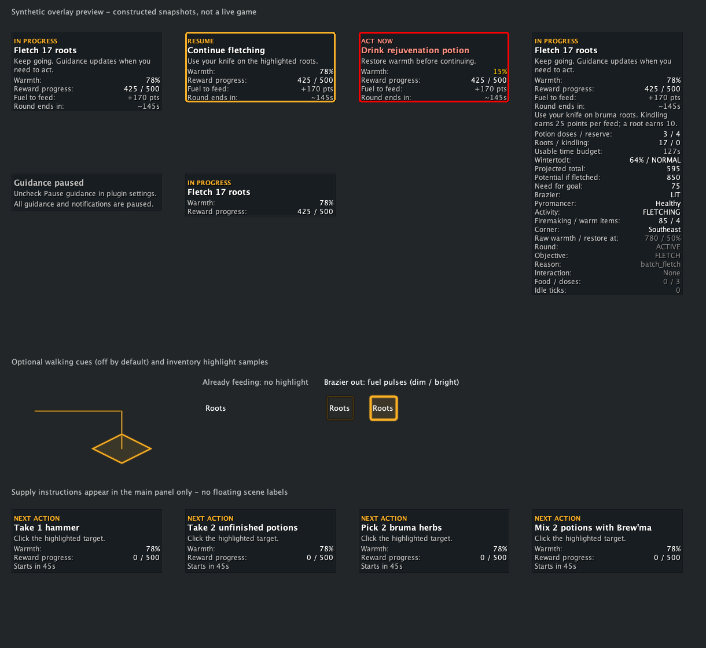
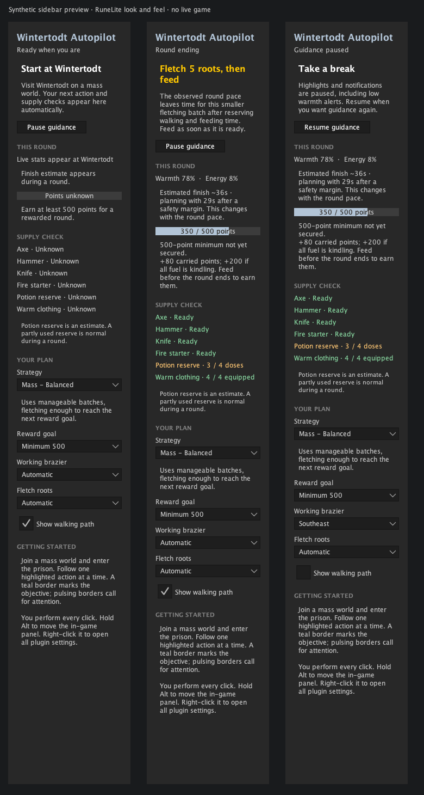

<p align="center">
  
</p>

# Wintertodt Autopilot

Wintertodt gets repetitive. Chop, fletch, feed, get interrupted, click again. This plugin keeps track of the round and shows you what to do next, with a highlight on the object or inventory item you need.

**You do every click.** Autopilot is the name of the guide. It doesn't move your character, click for you, or send game actions.

Built for mass worlds, with plans for Firemaking XP, points, or fewer task changes.

## What you get

- **One action at a time.** A clear instruction with a teal target highlight, inventory outlines, and optional walking cues.
- **A reminder when you stop.** Interrupted actions show a Resume cue. Pulsing borders draw your attention to low warmth, repairs, relighting, and fuel that needs feeding.
- **Warmth and supplies.** Guidance for tools, rejuvenation potions, drinking, and healing your local pyromancer. Potion reserves account for your Firemaking level, warm clothing, food, and the round.
- **A plan for your points.** Batches adjust to your inventory and reward goal. The panel separates points you've earned from points still sitting in your inventory.
- **Help finishing the round.** A finish estimate learns the recent energy drain and leaves time to walk and feed. If there's time for a smaller fletching batch, it'll suggest one.
- **Controls close by.** Change your strategy, reward goal, fletching mode, and working brazier from the sidebar. Pause guidance whenever you want.

## Getting started

The Plugin Hub submission is pending review. Until it's approved, use the developer build below.

Once available in the Hub:

1. Open RuneLite's Plugin Hub, search **Wintertodt Autopilot**, and install it.
2. Join a Wintertodt mass world and enable the plugin.
3. Click the brazier icon in the sidebar. Start with **Mass - Balanced** and leave your working brazier on **Automatic**.
4. Follow the current instruction. The plugin guides missing tool and potion preparation once you're inside the prison.

Hold **Alt** to move the in-game panel. Right-click the panel to open the plugin settings. You can turn off paths, standing tiles, inventory highlights, or the hint arrow individually, and choose Minimal, Normal, or Detailed panel views.

## Pick your plan

| Strategy | How it plays |
| --- | --- |
| **Mass - Balanced** | Manageable batches, with enough fletching to work toward the next reward goal. A good place to start. |
| **Mass - Firemaking XP** | Feeds roots directly by default. Uses small late-round batches when there's still time to chop and feed. |
| **Mass - Points / Rewards** | Larger batches and kindling, aimed at reward thresholds. |
| **Low Attention** | Fills available inventory space to reduce task changes. You still need to watch warmth and respond to interruptions. |

Fletching can follow the strategy, always be used, or be skipped. Late in the round, feeding may take priority. After you reach a fixed point goal, guidance continues toward the next 500-point threshold.

## A look at the panels

These previews use constructed game states to show the layout. They aren't in-game screenshots.



The sidebar explains the current step, checks your supplies, and keeps your round progress and settings together.



## A few things to know

This version is for mass worlds. Solo guidance isn't included.

Finish times and potion reserves are estimates. Round pace can change, and carried fuel only earns points once you feed it. Missing observations show as unknown instead of guessed values. Warm clothing and food detection may miss some items.

Walking cues cover the loaded scene. They don't operate doors or avoid incoming attacks. You still need to react to the game yourself.

**Pause guidance also pauses low-warmth notifications.** Resume from the sidebar when you're ready. Emergency warmth alerts are enabled by default; idle and other attention notifications are optional.

The full [live validation checklist](docs/LIVE_VALIDATION.md) is still open. Automated checks cover the planner and presentation, but the remaining in-game checks need to be completed.

## Bugs and suggestions

[Open an issue](https://github.com/alex-md/wintertodt-autopilot/issues) with what happened and what you expected. Include your strategy, working corner, warmth, points, and round energy if you can. A screenshot of the panel helps. Turn on **Debug overlay and logs** if you need the decision reason.

## Build it yourself

Use **Java 17**. The source targets Java 11 and pins RuneLite **1.13.1** and Gradle **8.10**.

```sh
./gradlew build
./gradlew run
```

`run` opens RuneLite in developer mode with the plugin loaded. Search **Wintertodt Autopilot** in the settings. For Jagex accounts, follow RuneLite's [developer-client setup](https://github.com/runelite/runelite/wiki/Using-Jagex-Accounts).

The local jar is `build/libs/wintertodt-autopilot-0.1.0.jar`. Hub installation requires RuneLite's source review and approval.

To regenerate the panel previews:

```sh
./gradlew previewOverlay previewSidebar
```

See [research and API mapping](docs/RESEARCH.md) for implementation details and [submission checks](docs/PLUGIN_HUB_SUBMISSION.md) for the Hub requirements checked for this release.

Licensed under [BSD 3-Clause](LICENSE). The adapted RuneLite animation table retains its attribution in [THIRD_PARTY_NOTICES](THIRD_PARTY_NOTICES). Both notices are included in the plugin jar.
