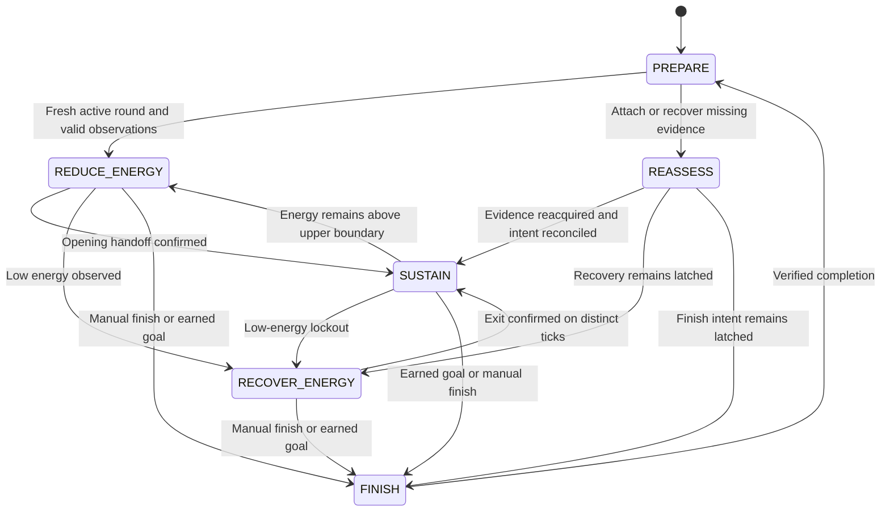

# Phase 3: dependable Solo Wintertodt guidance

Research and code review: **19 October 2026**. Baseline: **0.2.5**, commit `7d9e412dfc2fa7317a5bce768bb9e4611eb2eb52`, RuneLite **1.13.2**, Java 11 bytecode. This document is the original development proposal. **Release update, 21 October:** 0.3.0 removes the Solo preview label following the maintainer’s manual testing and release request. The original milestone acceptance matrix remains a record of broader follow-up work; see [progress](PHASE_3_PROGRESS.md) for what shipped. No gameplay implementation changes were made for this review.

Implementation has since begun on a development branch. See [Phase 3 progress](PHASE_3_PROGRESS.md) for completed code, automated evidence and open live gates; the baseline assessment below records the pre-implementation state.

**Recommendation:** retain the existing planner, immutable snapshots, corner observations, supply loop and presentation. Build Phase 3 around reliable observations, persistent encounter intent, explicit action commitments and measured live validation. Default to a comfortable, finite points run at one working corner. Keep more active healing and faster finishing as deliberate preferences.

The controller already implements most encounter phases. The work needed to graduate Solo is primarily to establish that its observations and decisions hold up in the game, close specific lifecycle and safety gaps, and make strategic tradeoffs explicit.

## A. Research findings

### Evidence and limitations

Evidence labels throughout this plan:

- **Verified source:** directly read game-update publication, RuneLite source/API, or current Wiki raw text. This verifies what the source says; it does not independently measure the server.
- **Verified code:** behavior or limitation directly established in this checkout.
- **Recommendation:** an engineering or gameplay choice proposed here.
- **Needs observation:** a runtime correspondence, timing distribution or performance claim that needs recorded gameplay.

Jagex's October 2024 changes and October 2024 healing adjustment were checked directly, alongside the April 2025 interface change. Both Wiki articles were retrieved through `?action=raw`; their ordinary pages were blocked by the web reader. The Wiki revision metadata API returned 403, so no exact revision identifier is claimed. No video was watched and no live RuneLite encounter was run in this review. First-person community reports provide practical examples, not controlled benchmarks.

### Mechanics that should drive the controller

| Mechanic | Evidence | Consequence |
| --- | --- | --- |
| Warmth replaces HP for encounter attacks; a rejuvenation dose restores 30%; eligible food restores 35%; zero warmth kills. | Jagex [2024 rework](https://secure.runescape.com/m=news/wintertodt-updates--varlamore-drop-rates?oldschool=1). | Use warmth, not HP, for survival decisions. Drink before optional healing. |
| Warmth naturally regenerates, with warm clothing and supported regeneration equipment improving it. | Same Jagex publication. | Reserves should reflect observed consumption; do not promise a fixed reserve lasts a whole run. |
| Healing a pyromancer now awards **75 points**, up from 30. | Jagex [16 October 2024 adjustment](https://secure.runescape.com/m=news/halloween-2024?oldschool=1). | Healing is a major points opportunity, with a real travel and potion cost. |
| The warmth bar changed shape in April 2025. | Jagex [Poll 84 update](https://secure.runescape.com/m=news/poll-84-misc-mayhem?oldschool=1). | Pixel geometry and old widget offsets need scrutiny. Prefer named components and explicit validation. |
| Feeding fuel earns score/XP; energy reduction comes from functioning braziers and pyromancers. | Current [Wiki strategy source](https://oldschool.runescape.wiki/w/Wintertodt/Strategies?action=raw), energy section. | Feeding existing fires can cash out fuel during recovery. Feeding does not itself accelerate the kill. |
| The strategy source describes one percentage point of drain per functioning corner per 14 ticks, and recovery of one point per 35 ticks once all braziers are out, with variable initial timing. | Same source. | Use as a diagnostic expectation, not a relight timer or finish guarantee. Rounded HUD energy obscures individual attacks. |
| Lower energy reduces ordinary interruptions and increases attacks on braziers/pyromancers. | Same source, including linked developer explanations. | Low energy improves sustained work but increases maintenance opportunities and the risk of accidental completion. There is no universal attack-frequency breakpoint. |
| Ordinary cold interrupts feeding/fletching but not chopping; area snow covers 3×3; brazier explosions hurt adjacent players. | Same source, attacks section. | Recognize interruption by progress as well as animation. Collision-safe walking alone does not establish hazard safety. |
| A downed pyromancer cannot drain or permit relighting until healed. | Current [Wiki encounter source](https://oldschool.runescape.wiki/w/Wintertodt?action=raw). | Track fire state separately from pyromancer state. “Lit count” is not “active drain count.” |
| Roots give 10 points, kindling 25, lighting/repairing 25; 500 earned points qualifies for rewards. Leaving/logging out loses current-round points. | Same encounter source. | Keep earned and carried score separate; completing a round is essential to securing its reward. |
| Current reward rules have no known per-round point cap; extra 500-point increments add reward entitlement. | Same encounter source, rewards section. | Do not use 13,500 as a current maximum or imply unlimited rounds are risk-free. The plugin's 100,000 goal limit is its own setting bound. |

The source timings above are descriptions of mechanics, not newly measured values. In particular, neither the last-fire extinction delay nor the lifetime of a newly lit fire has a deterministic deadline.

### Strategy comparison

| Approach | Main benefit | Cost and suitability |
| --- | --- | --- |
| Finite, comfortable points run | Kindling plus local repairs/healing; predictable goal and little travel | Recommended default. Preserve batches; optional healing waits for a useful stopping point. Retain the current 5,000 earned-point default until measured results justify changing it. |
| Active reward maximization | Fletch while moving and visit observed injured pyromancers | More clicks, walking and restocking. Useful for players choosing higher effort; not a comfortable default. |
| Solo Firemaking XP | Feed roots directly; conserve optional healing doses | Faster fuel throughput, fewer processing steps. The Wiki describes shorter 15–20-minute runs, but that is guidance, not a planner deadline. A 5,000-point goal alone does not define an XP-optimal run length. |
| Very long points session | Amortizes opening/finishing; avoids repeated setup | More unbanked progress exposed to disconnects, other players and forced logout. A later explicit extended-run objective can support this without making it the default. |
| Safer opening from preparation area | After lighting the arena, wait in safety and maintain nearby southern fires | Lower exposure but less productive time and potentially slower reduction. Offer only after the ordinary opening is validated. |
| Repeated fast completions / Mass | More completion bonuses and short commitments | Useful comparison for players primarily seeking FM XP/hour. Solo XP means optimizing the chosen Solo experience; it should not promise to beat every Mass method. |

The current [Wiki solo method](https://oldschool.runescape.wiki/w/Wintertodt/Strategies?action=raw) recommends reducing to roughly 20–30%, then concentrating locally. It also offers relaxed maintenance only when feeding, active healing during fletching, and one- or two-brazier finishes. These alternatives support configurable effort rather than a single universal optimum.

The same guide cautions against relighting below about 8% because one fire can sometimes drain several more percentage points before going out. The current 10% stop / 12% restart policy adds margin but remains a heuristic. It cannot guarantee indefinite sustain, particularly while other fires remain lit. Retain it provisionally; validate its actual risk before lowering it.

### Practical evidence and outdated advice

A [February 2025 player discussion](https://www.reddit.com/r/osrs/comments/1iljndg/solo_wintertodt_is_really_good_for_points_lol_not/) contains examples of multi-hour runs, players choosing 5–10k finishes after losing progress, and runs ended by other people lighting fires. Reports disagree about comfort and interruption frequency. This supports finite defaults, clear finishing and robustness to changing drain; it does not establish expected XP/hour.

The [2019 Theoatrix guide](https://www.theoatrix.net/post/wintertodt-solo-guide-osrs) remains useful historical context for the opening/local-sustain/finish pattern. Its 13,500 crate cap and 30-point healing advice are outdated. Likewise, guides promoting low HP as the current damage advantage conflict with Jagex's warmth rework. Do not carry those assumptions into Phase 3.

No numerical XP/hour or points/hour target is adopted from a guide. Benchmark the actual plugin with comparable account stats, equipment, strategy and total session time, including preparation and finishing.

## B. Current implementation assessment

### Retain and strengthen

| Component | Current behavior established from code | Phase 3 treatment |
| --- | --- | --- |
| `WintertodtPlanner`, `WintertodtSoloEngine` | Separate Mass and Solo decisions; shared warmth priority | Keep the boundary. Changes to Solo must preserve Mass behavior. |
| `WintertodtSnapshot`, `CornerObservation` | Immutable snapshot, unknown sentinels, per-corner source/timestamp/visibility | Extend with validity and transition evidence where needed. Avoid another parallel world model. |
| `WintertodtCornerTracker`, `WintertodtBrazierHud` | Scene-first observations; named HUD widgets, compass-layout decoding; disagreements invalidate remote readings | Preserve conservative behavior. Validate mapping in the live interface. |
| `WintertodtSoloEnergyModel` | Trend, gap handling, rapid-drop advisory, 10/12 recovery hysteresis | Keep observed trends and hysteresis; separate lifecycle-preserved recovery intent from transient samples. |
| `WintertodtSoloSupplyPlan` | 24-dose opening/working target; Points restock below 8, XP below 4; 8-dose finish target | Keep restock latch and fuel-first deferral. Measure reserves and travel cost before adapting them. |
| Batch state | Chopping commitment survives normal gaps; processing and feeding continue through a batch | Preserve the 0.2.4/0.2.5 fixes as explicit invariants. |
| Destination-aware objectives, paths and targets | Remote destinations are observed before interaction; collision-aware paths and optional manual gap jumps | Retain; incorporate travel cost in optional decisions rather than replacing routing. |
| Finish intent | Manual request latches; earned goal triggers finish; carried fuel feeds first; adjacent finish pair and low-run fallback | Keep player control and confirmation of earned score. Improve lifecycle reconciliation. |
| Presentation and traces | One action, built-in settings, quiet cues while working, `solo_observation_v1` | Extend existing mechanisms; no new sidebar or competing instruction stream. |

Code references: [Solo engine](../src/main/java/com/wintertodtautopilot/WintertodtSoloEngine.java), [state tracker](../src/main/java/com/wintertodtautopilot/WintertodtStateTracker.java), [plugin lifecycle](../src/main/java/com/wintertodtautopilot/WintertodtAutopilotPlugin.java), [supplies](../src/main/java/com/wintertodtautopilot/WintertodtSoloSupplyPlan.java), [guidance](../src/main/java/com/wintertodtautopilot/WintertodtGuidance.java).

### Concrete gaps and risks

1. **Loading resets more than observations.** `onGameStateChanged(LOADING/CONNECTION_LOST)` calls the full reset; only manual finish intent is restored. Recovery hysteresis, reduction latch, batch and route commitment are cleared. At 11% after loading, prior recovery can therefore be lost even though the previous recovery had not qualified to exit. Existing lifecycle tests cover finish intent, not that recovery case. This is a source-established gap, not a reported live failure.
2. **Clicks can masquerade as completed safety actions.** A potion click immediately sets `RESTORING_WARMTH`; shared safety then suppresses a new restore objective while that activity remains. If the interaction fails or is delayed, routine decisions can resume without confirmed warmth restoration. Add bounded pending-action handling and confirm progress; do not assume the click succeeded. Runtime impact needs observation.
3. **Action state is implicit.** `batch`, `batchTarget`, phase, route, activity and home interact across early returns. State changes can reset commitments for incidental reasons, including changes to all of `PlannerSettings`. Make the existing commitment explicit and define cancellation rules.
4. **Preparation is incomplete as a readiness model.** It checks tools and doses, but does not provide a complete distinction between required Firemaking eligibility, recommended warm clothing, unknown inventory data, and actual readiness. An unavailable item container currently reads like an empty bag. Unknown must not cause false missing-tool instructions.
5. **A fresh read is not necessarily fresh server health.** NPC health bars expose an approximate ratio and may be absent. Reading one again each tick does not prove a new damage event. Avoid promising exact HP, two-hit healing timing or same-tick rescues from this signal.
6. **Drain coverage has a blind spot.** Global lit-fire coverage can be known while remote pyromancer health is unknown. It supports conservative lighting checks, not exact active-drain forecasts. HUD pyromancer icons are currently unused.
7. **Fixed heuristics are not measured budgets.** Opening 28/35%, recovery 10/12%, rapid drain and potion thresholds are plausible choices. Threshold tuning lacks recorded outcome distributions.
8. **Hazards are not modeled.** No `GraphicsObjectCreated` or projectile hazard tracking exists; the pathfinder handles collision, not dangerous tiles. A comfortable complete loop needs verified warning cues, while movement remains manual.
9. **Effort and objective are conflated.** Points mode considers optional remote healing; XP mode waits for incapacitation. There is no independent comfortable-versus-active maintenance choice, optional run-duration goal, or explicit pause-for-break lifecycle.
10. **Observability stops at tick logs.** Logs lack raw HUD sprite/layout diagnostics, pending-versus-confirmed actions, recovery-episode identity and a per-run outcome summary. Existing automated replay uses constructed snapshots rather than captured encounters.

Baseline validation was rerun with `./gradlew test --rerun-tasks --no-daemon --console=plain`: **221 tests, zero failures/errors/skips**. This establishes the current automated baseline. [Live validation](LIVE_VALIDATION.md) still contains open gates; this review closes none of them.

## C. Recommended gameplay loop

**Default: finite Points / Rewards, comfortable maintenance, current nearby working corner, automatic fletching, existing 5,000 earned-point goal.** Keep explicit corner overrides. Southwest is a useful player-selected efficiency choice; automatically moving a settled player there is not necessary. The guide's geometry preference is a small optimization compared with stable instructions.

1. **Prepare:** establish region/round identity and valid inventory/equipment. Check 50 Firemaking, required tool alternatives and mixing access. Explain fewer than four warm items as a recommendation, not a fictional entry requirement. Prepare the current six-bottle reserve if starting a fresh encounter; accept a usable partial reserve on a verified mid-round attachment.
2. **Initialize:** obtain energy/score/warmth, current local scene state and available remote coverage. Distinguish fresh round, attachment to an active round, and reacquisition after loading. Missing HUD alone is not completion.
3. **Reduce:** maintain observed opening fires while energy is high, retaining the current 28% handoff provisionally. Avoid changing the destination halfway through an intentional trip. High-energy multi-corner maintenance can resume above the existing 35% upper boundary after sustained confirmation; exact confirmation is a tuning question.
4. **Stabilize:** finish the current useful work, stop maintaining the opening circuit and return to the working corner. This is a transition within the existing state machine, not a second controller. Observe residual remote fires; do not assume they vanished at the cutoff.
5. **Sustain:** chop a committed batch, fletch it if selected, then feed it. Comfortable maintenance waits for batch boundaries except when feeding is blocked. Maintain an eligible local fire; avoid restoring additional drain while remote fire evidence makes that inappropriate. Optional healing uses a personal warmth reserve and does not pull the player away after each root.
6. **Recover:** at the provisional low-energy boundary, suppress actions that resume drain. Continue useful gathering/processing/restocking, and feed an already lit brazier if sensible. Explain whether recovery is blocked by a remaining fire or is awaiting a fresh rise. Resume only after the recovery exit condition is observed again. Waiting is sometimes the correct action with a full bag.
7. **Adapt:** ordinary interruptions resume the same commitment. New danger, critical warmth, intentional finish, invalid observations or a verified round boundary preempt it. A rapid energy loss means reassess and cash out usable fuel when appropriate; do not infer another player's intent.
8. **Finish:** latch the manual request, or use confirmed earned score. Feed carried fuel before adding drain. Maintain the adjacent pair for a faster finish; use one local fire when run is depleted or a comfortable finish is selected. Low-energy relights are intentional here. Recheck warmth and observations throughout.
9. **Reset:** after verified completion, clear only round-owned intent and summarize earned result. Reconcile supplies for the next countdown. Leaving/logging out clears the session; temporary loading invalidates scene evidence while preserving intent until revalidated.

An extended-run option and a soft elapsed-round limit can follow core validation. Elapsed time observed by this plugin is not an authoritative account login timer; never display an exact forced-logout countdown from it.

## D. Technical architecture and integrations

### State and decision ownership

Retain `SoloPhase`: `PREPARE`, `REDUCE_ENERGY`, `SUSTAIN`, `RECOVER_ENERGY`, `FINISH`, `REASSESS`. Represent initialization/stabilization as explicit transition reasons rather than adding phases without distinct behavior. Completion remains `RoundState.COMPLETE`.

From every active phase, invalid required observations can enter `REASSESS`, and warmth/danger can temporarily preempt its objective. The diagram abbreviates those cross-cutting transitions. Raising the point goal may leave automatic finishing; it must not cancel a manual finish request.

Use a small encounter context owned by the Solo engine: intent, recovery latch, opening-complete latch, committed work stage/count, selected destination, and optional observed round age. It can begin as a private value object. Preserve it only across same-session observation loss; reacquire data before issuing actions. Never persist stale scene handles.

Decision order:

1. Verified lifecycle boundaries and observation invalidation.
2. Immediate personal warmth and verified imminent hazard response; if both apply, explicitly compose a short move-and-restore instruction rather than silently hiding either risk.
3. Required-signal validity and reconciliation.
4. Manual finish / earned objective, constrained by safety.
5. Recovery prohibition on restoring drain.
6. Critical supply recovery / blocked inventory handling.
7. Continue a valid committed action.
8. Routine supply trips and eligible maintenance at useful boundaries.
9. Optional local/remote healing, productive work, or explained waiting.

Mark each candidate action as allowed, blocked or inapplicable, with one reason. Centralize whether lighting/healing/repair can resume drain; reuse it across sustain, recovery and supply-space branches. Avoid building a generic workflow framework.

### RuneLite evidence matrix

All named APIs/IDs below were checked against 1.13.2 source; candidate events/constants were also checked with `javap` against the dependency JAR. **Existence of an ID does not verify its live meaning.**

| Signal | Supported access / information | Existing access and reliability | Proposed use |
| --- | --- | --- | --- |
| Tick boundary | `GameTick`, `Client.getTickCount()` | Already used. RuneLite documents it after packet processing. | Build one coherent snapshot and make one gameplay decision per tick. |
| Warmth | `getVarbitValue(VarbitID.WINT_WARMTH)`; ID 11434 | Already sampled; checkout scales 0–1000 to percent. Scale still needs HUD comparison. | Immediate safety; preserve raw value; client-frame cue clearing stays presentation-only. |
| Respawn timer | `WINT_TRANSMIT_RESPAWNDELAY` 7980 | Existing conversion `value * 30 / 50` also appears in RuneLite's built-in plugin. | Round-boundary corroboration, not proof from an absent widget. |
| Energy / earned points | `InterfaceID.WintStatus.ENERGY_TITLE`, fallback `ENERGY`, and `POINTS` | Existing widget parser. Supported component identifiers; text meaning/visibility are runtime assumptions. | Preserve raw text and validity; do not silently substitute zero. |
| Brazier HUD | `WintStatus.BRAZIER1`–`BRAZIER4`, `Widget.getSpriteId()/getBounds()` | Already decoded. Sprite semantics 1397/1398/1399 corroborated by Solo Helper; spatial mapping is local logic. | Live cross-check at every corner, scale and client layout; keep unknown/conflict rejection. |
| Pyromancer HUD | `WintStatus.PYRO1`–`PYRO4` | Available, not used. Legacy helper uses 1400 as down, accepts everything else as alive. | Investigate down-only remote evidence. Do not copy its permissive alive fallback or old offsets. |
| Physical brazier | Object spawn/despawn; transformed `ObjectComposition.getImpostor()`; `ObjectID.WINT_BRAZIER`, `_LIT`, `_BROKEN` | Existing object tracker. Current scene evidence is preferred. | Confirm transforms and eligibility immediately before guidance; bootstrap after scene invalidation. |
| Pyromancer | `NpcChanged`, `getTransformedComposition()`, `NpcID.WINT_WIZARD`, `_DOWN`; health ratio/scale | Existing NPC tracker. Ratio is approximate; -1 means missing. | Reliable standing/down classification when visible; optional healing from observed injury, no exact-HP prediction. |
| Inventory / equipment | `getItemContainer(InventoryID.INV/WORN)`, `ItemContainerChanged` | Sampled each tick; event available. Null containers currently lack a validity flag. | Explicit validity, progress confirmation, dose accounting and lightweight dirty tracking if needed. 28-slot sampling is already cheap. |
| Activity / score progress | `AnimationChanged`, `MenuOptionClicked`, inventory deltas, chat; optional `StatChanged` | Existing fused heuristic, except XP event. Click indicates intent, not success. | Bounded pending action, progress confirmation and interruption recognition. XP can corroborate but cannot identify the action alone. |
| Run and route eligibility | `Client.getEnergy()`, real/boosted skill levels, WorldView collision maps | Existing percentage conversion and 60-Agility gate. | Cost optional travel using existing routes; test unknown run energy, not just <=10%. |
| Snow warnings | `GraphicsObjectCreated.getGraphicsObject()`; `GraphicsObject.getId()/getLocation()/getStartCycle()/getWorldView()`; spotanims 1310/1311 | API and named `WINT_AREA_ATTACK_SPOT/IMPACT` exist; no integration. Warning footprint, timing and event delivery unverified. | Record first. Introduce temporary danger tiles and manual avoid cues only after warning/impact correspondence is proven. |
| Additional vars | `WINT_AREA_ATTACK` 5354, `WINT_REWARD_POOL` 11435, `VarPlayerID.WINT_INT` 4487 | IDs verified; encoding/visibility/semantics not established here. | Investigate via observed changes/cache scripts. Do not decode energy, coordinates or session state by guessing bits. |
| Projectile events | `ProjectileMoved.getProjectile()` | Available; Wintertodt-specific association not established. | Optional diagnostic for pyro attack cadence; not required for release and not a fabricated server scheduler. |

Primary technical references: [GameTick](https://github.com/runelite/runelite/blob/runelite-parent-1.13.2/runelite-api/src/main/java/net/runelite/api/events/GameTick.java), [Actor health API](https://github.com/runelite/runelite/blob/runelite-parent-1.13.2/runelite-api/src/main/java/net/runelite/api/Actor.java), [Client](https://github.com/runelite/runelite/blob/runelite-parent-1.13.2/runelite-api/src/main/java/net/runelite/api/Client.java), [InterfaceID](https://github.com/runelite/runelite/blob/runelite-parent-1.13.2/runelite-api/src/main/java/net/runelite/api/gameval/InterfaceID.java), [VarbitID](https://github.com/runelite/runelite/blob/runelite-parent-1.13.2/runelite-api/src/main/java/net/runelite/api/gameval/VarbitID.java), [SpotanimID](https://github.com/runelite/runelite/blob/runelite-parent-1.13.2/runelite-api/src/main/java/net/runelite/api/gameval/SpotanimID.java), [GraphicsObjectCreated](https://github.com/runelite/runelite/blob/runelite-parent-1.13.2/runelite-api/src/main/java/net/runelite/api/events/GraphicsObjectCreated.java), [GraphicsObject](https://github.com/runelite/runelite/blob/runelite-parent-1.13.2/runelite-api/src/main/java/net/runelite/api/GraphicsObject.java).

The [built-in Wintertodt plugin](https://github.com/runelite/runelite/blob/runelite-parent-1.13.2/runelite-client/src/main/java/net/runelite/client/plugins/wintertodt/WintertodtPlugin.java) provides established region, timer, animation and interruption patterns, not a Solo stabilization algorithm. [Solo Helper's brazier source](https://github.com/aquaosrs/wintertodt-solo-helper/blob/c5761f0224c834b79d76c0f1b25b7ce4964a2211/src/main/java/com/WintertodtSoloHelper/WintertodtBrazier.java) corroborates sprite meanings but includes legacy layout assumptions. No code was copied during this review.

### Component responsibilities

- **Trackers:** acquire facts, validity, provenance and observed transitions. No strategic decisions.
- **Snapshot:** immutable facts and small derived quantities, including separate known-lit and known-active-drain evidence.
- **Solo engine/context:** lifecycle, phase, goal, commitment and decision priorities.
- **Energy model:** observed trend/hysteresis and risk evidence; no exact extinction/recovery prediction.
- **Supply plan:** reserve target, restock transaction and ingredient/space feasibility. Personal warmth allowance is separate from optional healing spend.
- **Existing path layer:** reachable interaction positions and travel cost. A small hazard tracker can supply exclusions once verified; it does not control movement.
- **Guidance/overlays:** one clear action, honest waiting reasons, relevant targets only. Pending click does not equal confirmed progress.
- **Trace/replay:** versioned observations, decisions and encounter outcomes, independent from rendering.

## E. Prioritized implementation milestones

Priorities: **P0** correctness and trustworthy evidence; **P1** complete comfortable behavior; **P2** optional optimization. Sequence is deliberate. Acceptance thresholds below are proposed engineering gates, not claims that the present version meets them.

### M1 — Capture and reproduce the baseline (P0; first)

Extend existing debug traces with raw energy/points text, HUD sprite/layout/conflict status, validity, batch stage/target, intent and reset reason. Add a capture-to-replay adapter and a compact per-round outcome record. Preserve `v1` compatibility or explicitly version the new trace.

**Expected behavior:** a decision mismatch can be reconstructed from recorded observations.

**Accept when:** at least one manual opening/sustain/recovery/finish capture is available; replay produces the same objective/destination/reason sequence; duplicate/gapped ticks and invalid observations retain their original meaning; debug-off incurs no log formatting or unbounded storage. Redact account identifiers and chat unrelated to the encounter.

### M2 — Separate session intent from observation lifecycle (P0; depends on M1)

Introduce an explicit same-session reacquisition path; preserve recovery/opening/batch/finish intent, clear scene handles and trend samples, and reconcile before resuming. Clear context on a verified new round, hop, logout, mode change or departure. Unknown continuity enters reassessment.

**Expected behavior:** scene loading cannot turn an unfinished recovery into a sustain relight or turn a partial batch into one-root cycling.

**Accept when:** replay covers loading at 9%, 11% and 12% during recovery; loading mid-chop/fletch/feed; missing HUD; connection loss followed by logout; completion/countdown and subsequent round. No relight occurs at 11% solely because context was reset. Manual finish remains latched only within its valid session.

### M3 — Validate observations and action completion (P0; M1–M2)

Add inventory/equipment validity, distinguish action requested/in progress/progress confirmed/interrupted, bound pending-click suppression, and validate HUD compass/sprites against actual scene transitions. Keep emergency warmth actionable until restoration or a valid in-progress action is established.

**Expected behavior:** no false readiness or missing-tool cue from absent data; failed drinking cannot silently release survival priority.

**Accept when:** failed/delayed potion clicks, cold interruption and natural regeneration are distinguishable in captures; null containers and hidden/changed HUDs produce reassessment; all four brazier mappings match scene evidence in fixed, resizable and scaled layouts; unknown health is never treated as full health or exact HP. Include an unrecognized sprite regression case.

### M4 — Make comfortable commitments and maintenance policy explicit (P1; M2–M3)

Replace implicit batch coordination with a small committed work value. Define cancellation by verified boundary, safety, explicit finish, deliberate preference change or invalidated feasibility. Add one effort preference, **Comfortable / Active**, independent of Points/XP. Preserve old configuration keys and document the default migration.

**Expected behavior:** Comfortable finishes useful batches, repairs/relights when feeding needs it, and avoids optional remote healing trips. Active may heal observed injuries during processing/travel, subject to supply/run limits.

**Accept when:** six-root batches survive each-root fire changes, damage gaps and warmth recovery; feeding drains all intended fuel before chopping restarts; recovery-to-sustain retains target counts; changing irrelevant Mass settings does not cancel Solo work; explicit finish preempts on the next valid tick. Existing 0.2.4/0.2.5 regressions remain covered.

### M5 — Confirm and tune sustainable energy control (P0 release gate; M1–M4)

Centralize drain-restoring eligibility across relighting, recovery healing and supply-space recovery. Measure residual remote-fire drain and exit hysteresis. Differentiate known lit fires from known active pyromancers; retain unknown coverage when evidence is insufficient.

**Expected behavior:** opening hands off cleanly; sustain stays productive; recovery never adds unintended drain; abnormal pace gets a useful response.

**Accept when:** traces demonstrate opening-to-local transition, a complete recovery cycle and repeated sustain cycles; no recovery action restores drain; no duplicate tick satisfies exit; missing coverage blocks unsafe maintenance while independent productive work remains possible. Report every premature ending, its last relight energy, remaining fire evidence and finish intent. Do not lower the 10/12 band without a measured benefit and an explicit risk review.

### M6 — Complete readiness, supplies, finishing and reset (P1; M3–M5)

Add readable readiness status; calibrate personal versus healing allowance; retain latched restocking and fuel-first deferral. Support a comfortable one-fire finish and an active adjacent-pair finish. Ensure full-bag/downed-pyro/no-dose states have an achievable manual recovery instruction. Add an optional soft round-duration finish only after point-goal behavior is stable.

**Expected behavior:** repeated rounds require no hidden reset, mandatory bank automation or avoidable potion trip after each dose.

**Accept when:** test before/after Druidic Ritual, tool alternatives, zero/four warm items, partial bottles, mid-round attachment, all fuel-slot blocks and exhausted run. Warmth always wins over optional healing. Goal completion requires earned score; finish feeds usable fuel first; completion resets next-round preparation; raising a goal does not cancel manual finish. Duration is labeled as observed round time, never forced-logout time.

### M7 — Verify hazards and add restrained warning cues (P1; capture starts in M1; integration after M3)

Capture snow warning/impact graphics and brazier attack transitions; determine exact world footprint, lead time and expiry. Add manual avoid cues and temporary route exclusions only for verified hazards. Keep unknown effects diagnostic until understood.

**Expected behavior:** a known dangerous tile can interrupt routine guidance without repeated path oscillation or promising automatic dodging.

**Accept when:** at least ten matched warning/impact examples for each supported hazard class establish mapping; warnings expire after impact and clear on loading/pause; overlapping hazards and boundary tiles are tested; escape destinations are reachable and outside the verified footprint. At common interface scales, a user can distinguish movement danger from a maintenance pulse. If a hazard class remains unverified, document it explicitly and retain manual visual awareness.

### M8 — Comparative sessions and graduation (P0 release gate; M1–M7)

Run observation-only, shadow-guidance, then fully followed manual sessions. Compare comfortable points, active points and Solo XP using the same account/loadout and report full-session rates. Update the existing live checklist and documentation from evidence.

**Expected behavior:** the advertised strategy is predictable over repeated complete encounters, with documented tradeoffs.

**Accept when:** at least five consecutive comfortable points rounds and three complete rounds each of Active Points and Solo XP; at least three observed low-energy recovery episodes; both low/high-run finishing and all corners covered across the matrix. Require zero unexplained safety-priority failures, zero one-root batch thrashing, zero relights based on stale/unknown evidence, and a next-round reset after every finish. Any failure must be fixed and its affected sequence rerun. This sample is a minimum usability gate, not statistical proof of safety.

### M9 — Optional efficiency improvements (P2; after M8)

Consider travel-cost-aware remote healing, consumption-based reserve targets, a safe-area opening preference and explicit extended runs. Adapt estimates conservatively and keep hard minimum personal supplies. Do not introduce frame-perfect healing, automatic clicks, or a speculative learned controller.

**Expected behavior:** an optional feature produces measurable value without destabilizing the ordinary loop.

**Accept when:** paired sessions show the chosen metric improves, with no extra unsafe relights, inventory deadlocks or unexpected task switches; defaults and config migration are documented. Otherwise retain the simpler behavior.

## F. Validation and measurement

### Automated checks

Continue pure planner tests and tracker integration tests. Add capture replays for observed bugs, not tests that merely repeat implementation branches. Add invariant tests over sequences containing gaps, invalid values, transformations and state changes:

- No unintended maintenance that resumes drain during recovery.
- No unknown numeric reading becomes zero or a completed round.
- No carried score becomes earned score.
- No warmth-click intent is mistaken for confirmed restoration.
- No batch target collapses during an ordinary interruption or same-session reload.
- No target is resolved from the wrong corner or stale scene reference.
- Pause suppresses every cue and notification; resume reconciles current facts.
- A missing HUD cannot clear manual finish; a verified new session must clear it.

Use `./gradlew clean build previewOverlay --no-daemon --console=plain` and `git diff --check` when implementation milestones are integrated. Preview images verify synthetic rendering only. Verify frame-time impact with debug off/on, especially hazard capture and route invalidation; avoid repeated whole-scene scans outside bootstrap.

### Live scenario matrix

Cover fresh start and mid-round attachment; 50 versus higher Firemaking; ordinary and fletching knife; equipped alternatives; zero/four warm items; low/high run and <60/60+ Agility; fixed/resizable/scaled HUD; Automatic and each pinned corner; Points/XP and fletch overrides; full/partial/empty supplies; active/recovery/finish loading; hop/logout/return; and unexpected additional fires.

Compare energy, score, raw warmth, all corner sprites, actual objects, pyro transformations and warning graphics against video or timestamped observation notes. Event IDs alone are insufficient evidence. Do not intentionally endanger an account to test zero warmth; simulate lethal boundaries in tests and observe restoration comfortably above them.

### Outcome measures

Record whole-session FM XP/hour, points/hour and expected reward searches/hour; opening and finish duration; time by phase; minimum warmth; personal/healing dose spend; restock count; travel distance; optional healing points; action switches/minute; unnecessary repeat instructions; time blocked on unknown state; and premature completions. Include starting stats/equipment and earned finish score.

Reward rate is not the same as points/hour for short rounds because the initial qualifying reward matters. Compute entitlement using the verified current reward rules and confirmed earned score; do not treat fractional reward expectation as a guaranteed search. Compare strategies with preparation/finishing time included.

Agree on performance targets only after M1 establishes a measured baseline. The first target is reliable completion and comfortable behavior, followed by throughput improvements at comparable effort.

## G. Risks, unknowns and decisions

| Issue | Present conclusion | Resolution |
| --- | --- | --- |
| Random fire lifetime and residual remote drain | A low-energy floor reduces risk; cannot guarantee sustain. | Record outcomes in M5; show uncertainty rather than a guaranteed safe-relight label. |
| Live HUD correspondence | Named widgets exist; geometry/sprites still need runtime verification. | M3 capture matrix; unknown decoding fails conservatively. |
| Packed vars / remote pyro widgets | Promising APIs exist; semantics not established. | Inspect scripts and correlate live changes; omit any unsupported decoding. |
| Pyromancer health freshness | Approximate, sometimes missing, not an exact server HP feed. | Use standing/down and bounded injury evidence; no same-tick healing promises. |
| Hazard warning delivery/timing | Named graphics IDs exist; complete warning coverage is not proven. | M7 observation gate before danger routing. |
| Reconnect continuity | Client reconnect may preserve intent locally while the game has lost progress. | Reconcile round/score/countdown; do not replay old state blindly. |
| Shared arena | Empty visible scene does not prove exclusive control. | Detect changed drain evidence and warn neutrally; no automatic world hopping. |
| Long sessions | Loss on logout and uncertain remaining login time. | Finite default, clear finish control, optional conservative soft duration later. |
| Resource reserve | Six bottles consumes inventory space and may be excessive for comfort or inadequate for active healing. | Keep current reserve first; compare dose consumption and restock frequency before adapting. |
| Behavioral regression | Shared safety, tracker and presentation changes can affect Mass. | Run existing suite and targeted Mass live comparisons alongside Solo gates. |
| Effort preference migration | Existing Points users may expect remote healing. | Preserve saved strategy/goal keys; explicitly document Comfortable default and Active option. |

**Decisions to carry into implementation:** retain the architecture, keep finite points runs as the default, preserve productive batches and player-controlled interactions, prioritize lifecycle/safety evidence before new optimization, and originally retain the Solo preview label until the live graduation gates pass (superseded by the maintainer’s 0.3.0 release decision above). A build, source push, Plugin Hub review, distribution and live validation remain separate milestones; this planning task performs none of the release steps.

### Research retrieval record

The two Wiki raw responses were retrieved during this review. SHA-256 checksums identify the text inspected without implying a known Wiki revision:

- `Wintertodt?action=raw`: `510adc57c367ca496fa46a2e2a504d83bebf1844f6de77f75cab596e1704c04b`
- `Wintertodt/Strategies?action=raw`: `4860da967aed2ed19e36d51fea70319a000deab99046d2f75c65241d40cbeffa`

RuneLite references use `runelite-parent-1.13.2`; Solo Helper references use `c5761f0224c834b79d76c0f1b25b7ce4964a2211`. This pins the technical comparison to the current dependency and the source actually read. Later game or client revisions require another correspondence check.
